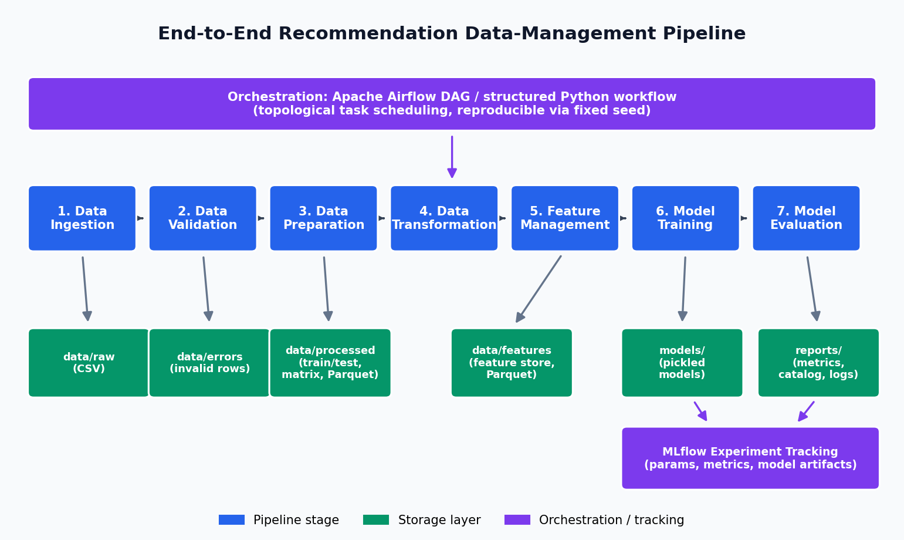

# End-to-End Data Management Pipeline for a Recommendation System

A modular, reproducible data-management pipeline for a MovieLens-style movie
recommendation system. It covers the full lifecycle — data ingestion,
validation, preparation, transformation, feature management, model training,
evaluation, and orchestration — and tracks every training run with MLflow.

The pipeline is built around a clean, well-documented codebase rather than a
single notebook, so each stage can be run, inspected, and reused independently.

## Pipeline stages

```
Data Ingestion → Data Validation → Data Preparation → Data Transformation →
Feature Management → Model Training → Model Evaluation → Orchestration
```



| Stage | Module | What it does |
|-------|--------|--------------|
| Ingestion | `src/ingestion/` | Generates a documented synthetic MovieLens-style dataset and reads the raw user / item / interaction CSVs. |
| Validation | `src/validation/` | Pandera schema checks + custom checks (missing values, duplicates, bad types, invalid ratings/timestamps, referential integrity). Invalid rows are quarantined with a reason. |
| Preparation & Transformation | `src/preparation/` | Cleans, standardises, drops cold users, and builds a **per-user time-based** train/test split plus derived datasets (user activity, item popularity, user-item matrix). |
| Feature Management | `src/features/` | Builds reusable user / item / interaction features and persists them as a feature store (reused for training *and* prediction). Emits a feature catalog. |
| Model Training | `src/training/` | Trains a popularity baseline and two personalised models (item-based CF, SVD matrix factorisation); logs params/metrics/artifacts to MLflow. |
| Model Evaluation | `src/evaluation/` | Precision@K, Recall@K, NDCG@K, Coverage, Diversity, and RMSE/MAE; writes a comparison table. |
| Orchestration | `src/orchestrate.py`, `dags/` | Runs the whole DAG in dependency order (plain Python) and ships an equivalent Apache Airflow DAG. |

## Dataset

The repository is self-contained: it generates a **documented synthetic
dataset** that mirrors the structure of MovieLens (explicit 1–5 ratings).
Synthetic generation lets the whole run be deterministic (fixed seed) and lets
the validation stage demonstrate real data-quality handling, because a small,
configurable fraction of rows is deliberately corrupted (missing ratings,
out-of-range ratings, invalid timestamps, dangling foreign keys, duplicates).

Interactions are produced from a latent-factor taste model (each user and item
has a hidden preference vector), so there is genuine collaborative structure
for the personalised models to recover — not just random noise. See
`src/ingestion/generate_data.py` for the full, commented generative model.

To use a real dataset instead, drop `users.csv`, `items.csv`, and
`interactions.csv` (with the same columns) into `data/raw/` and the pipeline
will pick them up without regenerating.

## Setup

Requires Python 3.8+.

```bash
# 1. (optional) create a virtual environment
python -m venv .venv && source .venv/bin/activate

# 2. install dependencies
pip install -r requirements.txt
```

## Running the pipeline

Run everything end-to-end with the structured Python orchestrator:

```bash
python -m src.orchestrate
```

This executes the stages in dependency order and prints a per-stage run summary.
All outputs are written under `data/` and `reports/`.

You can also run any stage on its own:

```bash
python -m src.ingestion.generate_data   # (re)generate the raw dataset
python -m src.ingestion.ingest          # Stage 1
python -m src.validation.validate       # Stage 2
python -m src.preparation.prepare       # Stages 3 & 4
python -m src.features.build_features    # Stage 5
python -m src.training.train            # Stages 6 & 7 (+ MLflow)
```

### Viewing the MLflow experiment

```bash
mlflow ui --backend-store-uri reports/mlruns
# then open http://127.0.0.1:5000
```

### Running under Apache Airflow (optional)

The DAG in `dags/recommendation_pipeline_dag.py` mirrors the Python
orchestrator. Point your Airflow `dags_folder` at the `dags/` directory (install
Airflow first — see the note in `requirements.txt`), then trigger the
`recommendation_pipeline` DAG.

### Regenerating the diagram, screenshots, and PDF report

```bash
python -m src.utils.make_architecture_diagram
python -m src.utils.capture_screenshots
python -m src.utils.make_report_figures
python -m src.utils.make_report            # builds reports/final_report.pdf
```

## Results

Metrics on the held-out time-based test split (K = 10). Higher is better for
ranking metrics; lower is better for RMSE/MAE.

| Model | Precision@10 | Recall@10 | NDCG@10 | Coverage | Diversity | RMSE | MAE |
|-------|-------------|-----------|---------|----------|-----------|------|-----|
| Popularity (baseline) | 0.0224 | 0.0330 | 0.0298 | 0.044 | 0.869 | 0.707 | 0.503 |
| Item-based CF | **0.0574** | **0.0806** | **0.0746** | **0.942** | 0.873 | 0.726 | 0.440 |
| Matrix factorisation (SVD) | 0.0425 | 0.0615 | 0.0623 | 0.620 | 0.871 | **0.669** | 0.443 |

Both personalised models clearly beat the non-personalised baseline on ranking
quality. Item-based collaborative filtering gives the best top-K ranking and the
widest catalog coverage; matrix factorisation gives the best explicit-rating
prediction (lowest RMSE). Exact numbers are reproducible via the fixed seed.

## Project structure

```
recommendation-pipeline/
├── configs/            # central config.yaml (all parameters live here)
├── data/
│   ├── raw/            # raw user / item / interaction CSVs
│   ├── processed/      # clean data, train/test, derived datasets, matrix
│   ├── features/       # persisted feature store (Parquet)
│   └── errors/         # quarantined invalid rows + validation report (JSON)
├── src/
│   ├── ingestion/      # data generation + ingestion
│   ├── validation/     # Pandera + custom data-quality checks
│   ├── preparation/    # cleaning, time split, derived datasets
│   ├── features/       # feature engineering + feature catalog
│   ├── training/       # models + MLflow training driver
│   ├── evaluation/     # ranking + rating metrics
│   ├── utils/          # config/logging + diagram/report generators
│   └── orchestrate.py  # structured Python DAG runner
├── dags/               # Apache Airflow DAG
├── models/             # pickled trained models
├── reports/            # metrics, catalogs, logs, diagram, screenshots, PDF
│   ├── mlruns/         # MLflow tracking store
│   └── screenshots/    # per-stage execution screenshots
├── requirements.txt
└── README.md
```

## Design choices (summary)

- **Config-driven & seeded** — every parameter is in `configs/config.yaml` and
  a single seed makes runs reproducible.
- **Validation before preparation** — ingestion is deliberately lenient so the
  validation stage sees and reports the data exactly as it arrived.
- **Time-based split** — the most recent slice of each user's history is held
  out, mimicking the real "predict the future" task and avoiding leakage.
- **A feature store, not ad-hoc features** — the same definitions are reused at
  train and predict time via `load_feature_store()`.
- **Two orchestration options** — a dependency-free Python runner for easy
  reproduction, plus an equivalent Airflow DAG for scheduled production use.

See `reports/final_report.pdf` for the full design discussion, results, and
limitations.
